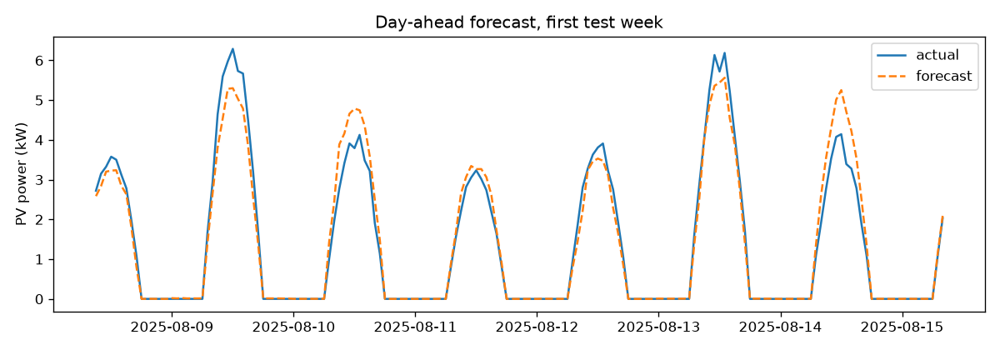

# Solar Forecast — previsão fotovoltaica day-ahead com meteorologia real

Dashboard e pipeline de ML que preveem a produção horária de uma instalação fotovoltaica para o dia seguinte, e a comparam com baselines simples. Útil para instaladores, comunidades de energia e gestão de autoconsumo.

**Resultado (Aveiro, 2 anos de dados reais Open-Meteo, 5 kWp):** o modelo reduz o RMSE em cerca de **30 %** face à persistência (t-24h), num teste estritamente posterior ao treino. Os valores exatos aparecem no dashboard e variam com a localização e o período.



## Dashboard
```bash
pip install -r requirements.txt
streamlit run app.py
```
Escolhe a localização (Aveiro, Lisboa, Porto, Faro), a potência instalada e o histórico; vê métricas, previsão vs real, baselines e erro por hora. Pode ser publicado gratuitamente no Streamlit Community Cloud (ficheiro principal: `app.py`).

## Rigor metodológico
- **Sem fuga temporal:** todas as variáveis derivadas da potência têm desfasamento ≥ 24 h; há um teste que perturba o futuro e verifica que o passado não muda.
- **Divisão cronológica** e validação cruzada com janelas expansivas (`TimeSeriesSplit`).
- **Baselines:** persistência (t-24h) e sazonal ingénua (t-168h), com MAE diurno para não ser inflacionado pelos zeros noturnos.

## Dados e limitações (leitura obrigatória)
- Meteorologia **real** (irradiância, temperatura, nebulosidade) via [Open-Meteo](https://open-meteo.com), sem chave de API.
- A produção **não é medida**: é estimada por um modelo físico simplificado (estilo PVWatts, com perda por temperatura e rácio de desempenho de 0,85). Com dados de um inversor real, basta substituir `pv_kw`.
- As variáveis meteorológicas são observadas (reanálise), não previsões históricas de NWP; isto é otimista face a um cenário de produção.
- Existe também um gerador sintético (`python -m enfc.cli`) para testes reproduzíveis.

## Estrutura
`src/enfc/real_data.py` (dados e modelo PV) · `features.py` · `model.py` · `cli.py` (relatório) · `app.py` (dashboard) · `tests/`.

```bash
python -m pytest tests
```
